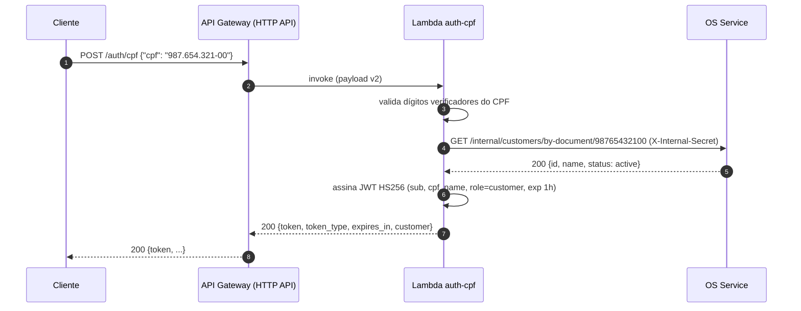
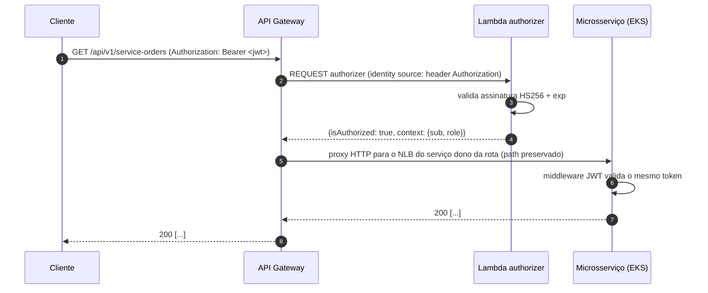
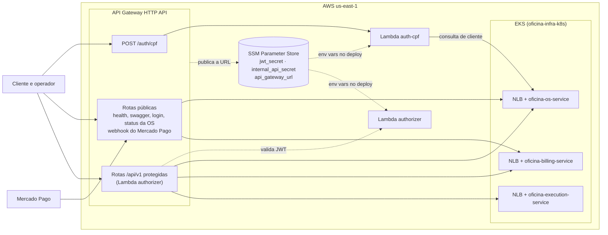

# oficina-lambda-auth — Autenticação por CPF (Serverless) + API Gateway

[](https://github.com/gaabriel165/oficina-lambda-auth/actions/workflows/ci.yml)
[](https://github.com/gaabriel165/oficina-lambda-auth/actions/workflows/cd.yml)

Repositório da **Function Serverless de autenticação** e do **API Gateway** do Tech Challenge da pós-graduação em Arquitetura de Software (FIAP SOAT) — Fases 3 e 4. É um dos seis repositórios do projeto:

| Repositório | Papel |
|---|---|
| [`oficina-os-service`](https://github.com/gaabriel165/oficina-os-service) | Ordens de serviço, clientes, veículos e orquestração da saga |
| [`oficina-billing-service`](https://github.com/gaabriel165/oficina-billing-service) | Orçamento e pagamento |
| [`oficina-execution-service`](https://github.com/gaabriel165/oficina-execution-service) | Diagnóstico, execução, catálogo e estoque |
| [`oficina-infra-k8s`](https://github.com/gaabriel165/oficina-infra-k8s) | VPC, EKS, ECR e roles OIDC (Terraform) |
| [`oficina-infra-db`](https://github.com/gaabriel165/oficina-infra-db) | RDS PostgreSQL do OS Service (Terraform) |
| **`oficina-lambda-auth`** (este) | Lambda de autenticação por CPF, Lambda authorizer e API Gateway |

## Propósito

O cliente da oficina se identifica apenas com o **CPF**. A função `auth-cpf`:

1. Valida o CPF (dígitos verificadores, rejeita sequências repetidas);
2. Consulta a **existência** e o **status** do cliente no OS Service, pela rota interna `GET /internal/customers/by-document/{document}` (autenticada com o cabeçalho `X-Internal-Secret`);
3. Emite um **JWT** (HS256, 1 h) aceito pelas APIs protegidas.

O **API Gateway** é a única porta de entrada: expõe a rota de autenticação e roteia cada caminho para o microsserviço dono do recurso no EKS. Rotas sensíveis (`/api/v1/*`) passam pelo **Lambda authorizer**, que valida o JWT antes de encaminhar. Rotas públicas (login administrativo, consulta de status, webhook do Mercado Pago, health e Swagger) seguem direto.

Na Fase 4 a função deixou de acessar o banco de dados: cada microsserviço é dono dos seus dados, então a consulta de cliente passou a ser uma chamada REST ao OS Service. Com isso a Lambda saiu da VPC e este repositório não depende mais do `oficina-infra-db`.

### Roteamento

| Rota | Autenticação na borda | Destino |
|---|---|---|
| `POST /auth/cpf` | nenhuma | Lambda `auth-cpf` |
| `GET /health`, `GET /swagger/{proxy+}` | nenhuma | OS Service |
| `POST /api/v1/auth/login`, `POST /api/v1/auth/register` | nenhuma | OS Service |
| `GET /api/v1/service-orders/{id}/status` | nenhuma | OS Service |
| `POST /api/v1/webhooks/mercadopago` | assinatura `x-signature`, validada pelo Billing Service | Billing Service |
| `ANY /api/v1/budgets`, `/budgets/{proxy+}`, `/payments/{proxy+}` | Lambda authorizer | Billing Service |
| `ANY /api/v1/parts`, `/services`, `/work-orders` e subcaminhos | Lambda authorizer | Execution Service |
| `ANY /api/v1/{proxy+}` | Lambda authorizer | OS Service |

O API Gateway escolhe a rota mais específica, então os caminhos do Billing e do Execution têm prioridade sobre o `ANY /api/v1/{proxy+}` do OS Service.

## Tecnologias

| Categoria | Tecnologias |
|---|---|
| Runtime | Go 1.25, AWS Lambda (`provided.al2023`, arm64) |
| Bibliotecas | `aws-lambda-go`, `net/http`, `golang-jwt/v5`, `log/slog` (logs JSON) |
| Gateway | AWS API Gateway **HTTP API** (integração Lambda proxy + HTTP proxy para o NLB de cada microsserviço) |
| Segredos | AWS SSM Parameter Store (`/oficina-api/jwt_secret`, `/oficina-api/internal_api_secret`) |
| IaC | Terraform (state remoto em S3, lê o state de `oficina-infra-k8s`) |
| CI/CD | GitHub Actions com OIDC (sem chave estática) |
| Testes | Testify |

## Como funciona

### Autenticação por CPF



Respostas possíveis: `400` CPF inválido ou body inválido · `404` cliente não encontrado · `403` cliente inativo · `502` OS Service indisponível · `500` erro interno.

### Consumo de rota protegida



O API Gateway cacheia a decisão do authorizer por 5 minutos para o mesmo header `Authorization`.

## Arquitetura deste repositório



Estrutura de pastas:

```
cmd/auth-cpf/          → handler da autenticação por CPF
cmd/authorizer/        → handler do Lambda authorizer
internal/cpf/          → validação e mascaramento de CPF
internal/customer/     → modelo + repositório HTTP (consulta ao OS Service)
internal/token/        → emissão e verificação do JWT
internal/auth/         → caso de uso Authenticate (CPF → cliente ativo → token)
internal/httpresponse/ → respostas JSON do API Gateway
terraform/             → Lambda, IAM, API Gateway, rotas, authorizer, logs
.github/workflows/     → CI (PR) e CD (main)
```

## Execução local

```bash
make test    # go vet + testes unitários com cobertura
make build   # gera build/auth-cpf.zip e build/authorizer.zip (linux/arm64)
```

Não há Dockerfile: a função é empacotada como binário estático (`bootstrap`) em zip, formato nativo do runtime `provided.al2023`.

## Deploy

O deploy é **automático** pelo GitHub Actions:

- **`ci.yml`** (Pull Request): vet, testes, build dos pacotes, `terraform fmt/validate` e `terraform plan` contra a AWS.
- **`cd.yml`** (merge na `main`): build, `terraform apply` e smoke test em `GET /health` pelo gateway.

A branch `main` é protegida: sem commits diretos, merge somente via Pull Request com o CI verde.

### Configuração no GitHub (Settings → Secrets and variables → Actions)

| Tipo | Nome | Valor |
|---|---|---|
| Variable | `AWS_REGION` | `us-east-1` |
| Secret | `AWS_ROLE_ARN` | output `lambda_github_actions_role_arn` do repositório `oficina-infra-k8s` |

### Dependências

Este repositório é o **último** a subir e o **primeiro** a descer:

1. `oficina-infra-k8s` aplicado (state `k8s/`): parâmetros `/oficina-api/jwt_secret` e `/oficina-api/internal_api_secret`.
2. Os três microsserviços deployados no EKS: cada `Service` cria um NLB, descoberto pela tag `kubernetes.io/service-name` (`oficina-api/oficina-api`, `oficina-billing/oficina-billing-service` e `oficina-execution/oficina-execution-service`). Alternativamente informe `backend_urls` em `terraform.tfvars`.

Depois do primeiro `apply`, a URL do gateway fica em `/oficina-api/api_gateway_url`. O Billing Service lê esse parâmetro no deploy para montar o endereço do webhook do Mercado Pago, então o CD dele deve ser executado de novo quando o gateway é recriado.

### Deploy manual

```bash
make build
cd terraform
terraform init
terraform plan
terraform apply
terraform output api_gateway_url
```

## Exemplos de uso

```bash
GW=$(terraform -chdir=terraform output -raw api_gateway_url)

# 1. Autenticar com o CPF de um cliente do seed
curl -s -X POST "$GW/auth/cpf" \
  -H "Content-Type: application/json" \
  -d '{"cpf":"98765432100"}'
# {"token":"eyJ...","token_type":"Bearer","expires_in":3600,"customer":{"id":"...","name":"João Carlos Silva"}}

# 2. Consumir uma rota protegida com o token
TOKEN=$(curl -s -X POST "$GW/auth/cpf" -H "Content-Type: application/json" -d '{"cpf":"98765432100"}' | jq -r .token)
curl -s "$GW/api/v1/service-orders" -H "Authorization: Bearer $TOKEN"

# 3. Sem token → 401 do API Gateway
curl -i "$GW/api/v1/service-orders"

# 4. CPF inexistente → 404 · CPF inválido → 400 · cliente inativo → 403
curl -s -X POST "$GW/auth/cpf" -H "Content-Type: application/json" -d '{"cpf":"52998224725"}'
```

**Swagger** (com o ambiente no ar): `https://<api-id>.execute-api.us-east-1.amazonaws.com/swagger/index.html`

## Destruir o ambiente

A infraestrutura é provisionada **sob demanda** (o ambiente sobe para testes e gravação e é destruído em seguida para não gerar custo). Ordem de destroy: **este repositório primeiro**, depois os três microsserviços (CD com a ação `destroy`), `oficina-infra-db` e, por último, `oficina-infra-k8s`.

```bash
terraform -chdir=terraform destroy
```

## Observabilidade

- Logs estruturados em **JSON** (`log/slog`) com `request_id` do API Gateway, `event` (`auth.cpf`, `auth.authorize`), `outcome` e CPF mascarado (`987******00`) — nunca o CPF completo.
- Access logs do API Gateway em JSON (`requestId`, `routeKey`, `status`, `integrationLatency`, `responseLatency`) no CloudWatch, retenção de 7 dias.
